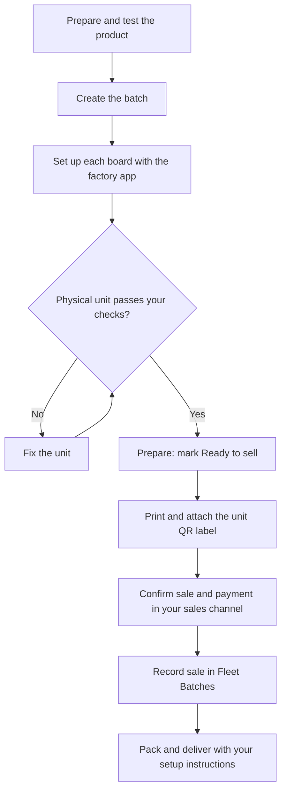
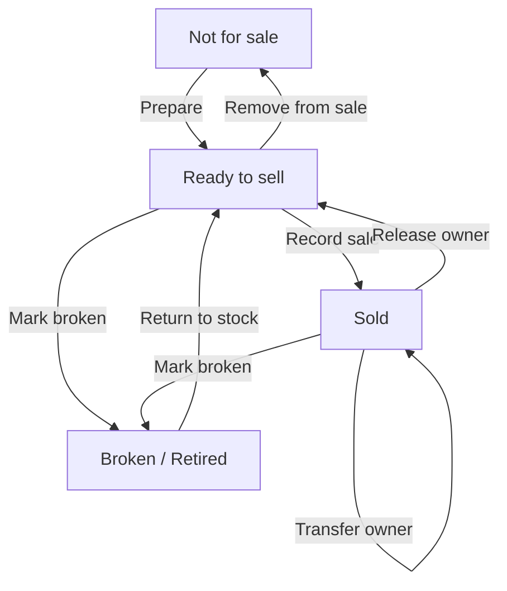
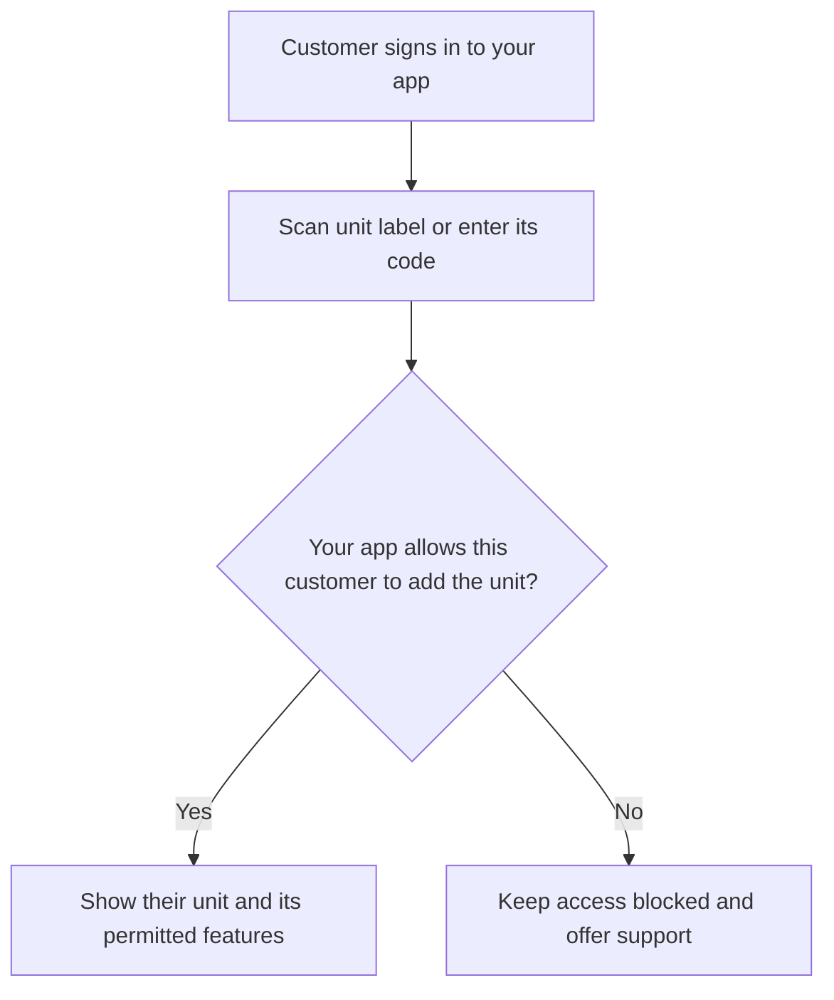

Follow these diagrams alongside the step-by-step guides. Each diagram shows one part of preparing, selling, and supporting your device product.

## From production to delivery

A batch creates device records. Each physical unit still needs factory setup and your product checks. Confirm payment through your own sales channel before recording the sale.

Continue with [Prepare your device product](/fleet-batches/prepare), [Create and manage a batch](/fleet-batches/create-batch), [Factory setup and unit checks](/fleet-batches/factory-checks), and [Sell and deliver devices](/fleet-batches/sell-and-deliver).

## Stock and ownership changes

These actions update the unit record. **Sold** means an owner has been recorded. A return or transfer also needs the matching update to customer permissions in your app.

Read [Sell and deliver devices](/fleet-batches/sell-and-deliver) for the buttons, buyer details, returns, and label handling.

## Customer access through your app

You provide the customer app and its permission checks. A printed code identifies a unit; scanning it does not grant access by itself.

Read [Customer access](/fleet-batches/customer-access) for the complete customer journey and the changes needed after a return or transfer.
