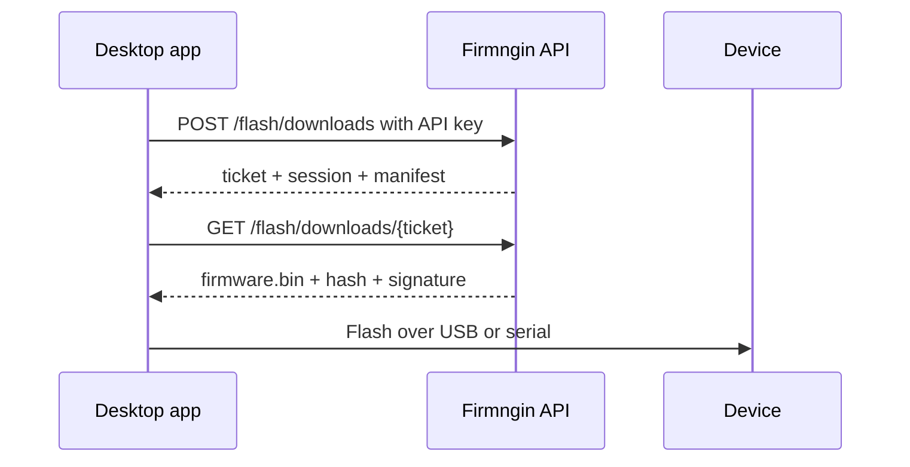
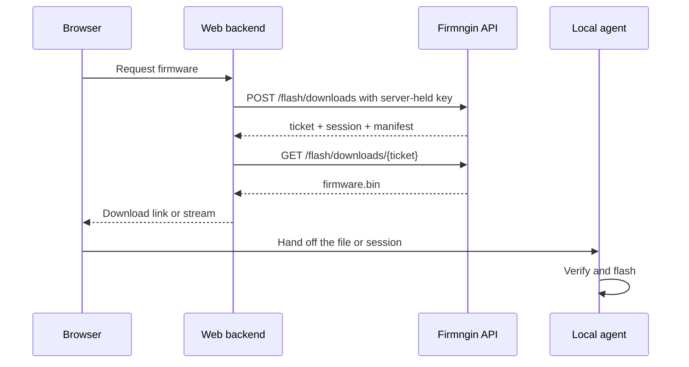
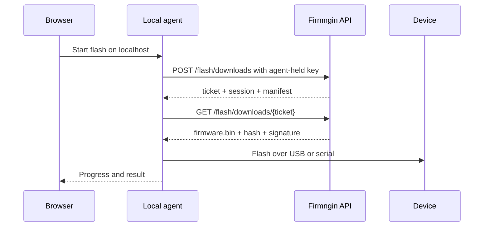

The local flash API is HTTP-only and client-agnostic. The same endpoints work from a native app, a web backend, or a local agent. The difference is **where the API key lives** and **which process has USB or serial access**.

## At a glance

| Pattern | Can download | Can flash | Recommended for |
| --- | --- | --- | --- |
| Native app (example: desktop) | Yes | Yes, USB or serial | Native installer, Tauri, Electron, CLI |
| Web app + backend (BFF) | Yes, server-side | No, hand off to a local agent | SaaS dashboard |
| Web app + local agent | Yes, agent | Yes, agent | Browser UI with local hardware |
| Browser only | Yes, if CORS allows | Limited (Chromium Web Serial) | Prototypes only |

<Warning>
  Never put a workspace API key in browser JavaScript, `localStorage`, or a public bundle. Use a backend or a local agent.
</Warning>

## Example: desktop app

The desktop app is one example. A CLI or another native client uses the same flow.

- Download and verify in the app.
- Flash from memory, or from a verified file descriptor.
- Send the advisory report after the flash.

## Web app with a backend

- The browser never sees the API key.
- The backend uses a server-side API key.
- Flashing needs a local agent or companion with USB access.
- Protect the backend with session auth, CSRF checks, and an origin allowlist.

## Web app with a local agent

- The agent runs on the user's machine and performs the Firmngin calls.
- The browser talks to `127.0.0.1` over a local API.
- Bind the local API to loopback, check the origin, and never expose it on the LAN.

## Browser only

A browser-only app can call the API when CORS allows it, but:

- Web Serial works in Chromium desktop, not Safari, Firefox, or Android browsers.
- Mobile browsers cannot reliably flash a device over USB.
- The API key must not be embedded in the page.
- Treat browser-only as a download or preview client, not as a flasher.

## Same API, different client

The endpoints do not change. Only the process that calls them and the process that flashes change.

| Step | Native app | Web + backend | Web + agent |
| --- | --- | --- | --- |
| Create ticket | App | Backend | Agent |
| Download | App | Backend | Agent |
| Verify | App | Backend or browser | Agent |
| Flash | App | Agent | Agent |
| Report | App | Backend | Agent |

## Security checklist

- [ ] The API key is not in browser JavaScript or `localStorage`.
- [ ] The installation private key lives in a platform secure store.
- [ ] Backend credentials are not committed to the repository.
- [ ] The local agent binds to `127.0.0.1` and checks the caller origin.
- [ ] The browser cannot call Firmngin directly with a long-lived key.
- [ ] The flashing process verifies SHA-256 and signature before writing.
