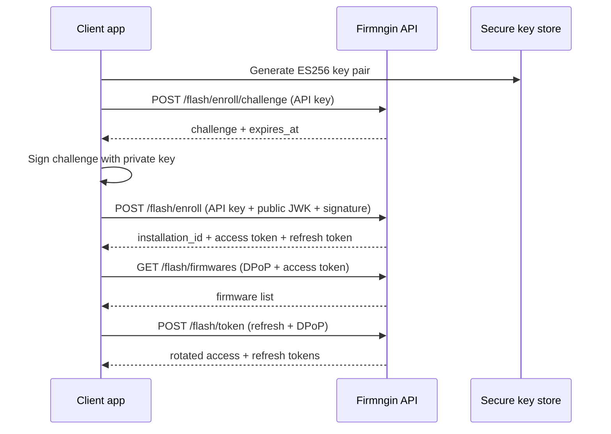

The flash API has two authentication modes. This page covers **enrollment + DPoP**; for the API key mode, see [API authentication](/local-flash/api).

Enrollment gives the client a **per-installation identity**:

- The API key is used once to enroll the installation.
- The client generates an **ES256 (P-256)** key pair and keeps the private key in a platform secure store.
- The client receives a 15-minute access token and a 30-day refresh token.
- Every data request presents `Authorization: DPoP <access-token>` plus a `DPoP` proof header.

Choose enrollment when the app is distributed across user machines, when a leaked API key should not be enough to act as an existing installation, or when you need to revoke one machine without revoking the whole key. For a simple internal tool, the API key mode is usually enough.

<Note>
  One API key can have at most **3 active installations**. Revoke an old installation before enrolling a replacement.
</Note>

## Flow



## 1. Request a challenge

```http
POST /api/saas/v1/flash/enroll/challenge
Authorization: Bearer fng_pat_...
```

```json
{
  "data": {
    "challenge": "…",
    "expires_at": "2026-11-04T10:10:00Z"
  }
}
```

The challenge is single-use and expires after five minutes.

## 2. Enroll the installation

Sign the challenge string with the installation private key, then send the public JWK and signature.

```http
POST /api/saas/v1/flash/enroll
Authorization: Bearer fng_pat_...
Content-Type: application/json
```

```json
{
  "challenge": "…",
  "public_key_jwk": {
    "kty": "EC",
    "crv": "P-256",
    "x": "…",
    "y": "…"
  },
  "signature": "…",
  "app_name": "flash-tool",
  "app_version": "1.0.0",
  "build_hash": "…",
  "os": "windows",
  "machine_hash": "…"
}
```

`signature` is the ES256 signature over the challenge bytes, base64url or standard base64. `public_key_jwk` must be an EC P-256 key.

```json
{
  "data": {
    "installation_id": "…",
    "status": "active",
    "access_token": "…",
    "token_type": "DPoP",
    "expires_in": 900,
    "refresh_token": "…"
  }
}
```

The refresh token is returned once. Store it in the same platform secure store.

## 3. Call data endpoints

```http
GET /api/saas/v1/flash/firmwares
Authorization: DPoP <access-token>
DPoP: <proof-jwt>
```

The proof is an ES256 JWT with:

| Claim | Value |
| --- | --- |
| `htm` | HTTP method, for example `GET` |
| `htu` | Full public URL without query, for example `https://api.firmngin.dev/api/saas/v1/flash/firmwares` |
| `iat` | Current Unix time; accepted within 60 seconds |
| `jti` | Unique proof id |
| `ath` | Base64url SHA-256 of the access token |

The proof header must include `typ: "dpop+jwt"` and the installation public key in `jwk`.

## 4. Refresh

```http
POST /api/saas/v1/flash/token
Content-Type: application/json
DPoP: <proof-jwt>

{ "refresh_token": "…" }
```

The refresh request uses a DPoP proof without `ath`. Refresh tokens rotate on every use; reusing an old token revokes the whole family.

## 5. Manage installations

```http
GET /api/saas/v1/flash/installations
Authorization: Bearer fng_pat_...
```

```http
POST /api/saas/v1/flash/installations/{id}/revoke
Authorization: Bearer fng_pat_...
```

Revoking an installation invalidates its access tokens (checked on the next request) and its refresh tokens.

## Key storage

The API only receives the public JWK; the private key never leaves the client. Use any secure store that protects the key and can sign. The table below is a set of examples, not a requirement. A web app should keep the key on its backend or in a local agent, never in browser storage.

| OS | Hardware-backed | OS-protected fallback | Notes |
| --- | --- | --- | --- |
| Windows | TPM 2.0 via CNG Platform Crypto Provider | Microsoft Software KSP, DPAPI, Credential Manager | Use a persisted CNG key with export policy none. |
| Linux | TPM 2.0 via `tpm2-tss` (optional) | libsecret (GNOME Keyring), KWallet | TPM is not universal; sandbox may block D-Bus or TPM. |
| macOS | Secure Enclave (P-256) | Keychain | Secure Enclave does not support Ed25519. |
| Android | Android Keystore (TEE/StrongBox) | Keystore | StrongBox is not available on every device. |

Hardware-backed stores are stronger because the private key cannot be exported. Software stores protect the key at rest, but the app can read it to sign.

<Warning>
  A software key store protects the key at rest. Only a hardware-backed store (TPM, Secure Enclave, Android Keystore, or equivalent) can make it non-exportable. If your threat model needs that, use the hardware-backed provider and fail closed when it is unavailable.
</Warning>

### Windows

Use CNG with `CngKey.Create` and `CngExportPolicies.None`. Prefer the TPM provider; fall back to the software provider only when the TPM is unavailable.

```csharp
var parameters = new CngKeyCreationParameters {
    Provider = CngProvider.MicrosoftPlatformCryptoProvider,
    ExportPolicy = CngExportPolicies.None,
    KeyUsage = CngKeyUsages.Signing,
};
using var key = CngKey.Create(CngAlgorithm.ECDsaP256, "firmngin-flash", parameters);
using var ecdsa = new ECDsaCng(key);
var signature = ecdsa.SignHash(SHA256.HashData(Encoding.UTF8.GetBytes(challenge)));
```

### Linux

There is no single cross-platform secure store. Options, strongest first:

1. **TPM 2.0** via `tpm2-tss` or `tpm2-pkcs11`: non-exportable, but not available on every machine and may need device permissions.
2. **libsecret / KWallet** over D-Bus: store the PKCS#8 key encrypted at rest; the app reads it to sign.
3. **`0600` file** in the user data directory, encrypted with a key from the platform keyring. This is a fallback, not hardware-backed.

```bash
# libsecret example: store a PKCS#8 key
secret-tool store --label="firmngin flash key" service firmngin type installation < key.pk8
```

## Notes

- Only **ES256 / P-256** is supported.
- The client must use the same public URL for `htu` that the API sees. Set `URL_BACKEND` on the server when it runs behind a proxy.
- Store the private key in a platform secure store; never send it to the API.
- Access tokens live 15 minutes. Refresh tokens live 30 days and rotate.
- This mode uses the API key only for enrollment. Data requests use DPoP.
