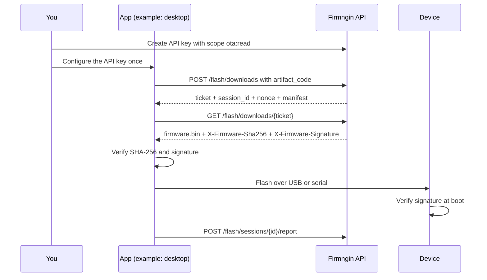
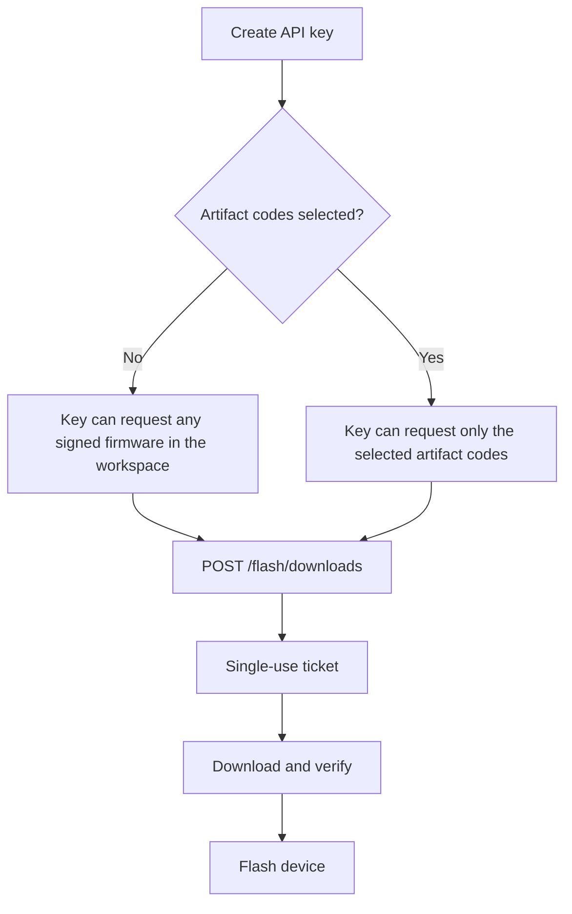

Local flash lets any client — a native app, a CLI, or a web app with a local agent — deliver firmware to devices over USB or serial. This section covers third-party apps and tools that flash devices locally. The client requests a signed image from Firmngin, verifies it, and flashes the connected device. It does not need a Firmngin login: you create a scoped API key in the dashboard once, and the client uses it to request short-lived download tickets.

This guide uses a **desktop app** as the running example. The desktop app is only an example, not a requirement: the same API works for a CLI, a factory tool, or a web app that hands the flash to a local agent.

Web apps can use the same API through a backend or a local agent. A browser cannot flash a device by itself. See [Client patterns](/local-flash/client-patterns) for native, backend, and local-agent flows.

<Note>
  Local flash is different from cloud OTA. Cloud OTA pushes an update through Firmngin and the device pulls it over MQTT. Local flash is for devices that are physically connected to the app.
</Note>

## Authentication modes

Both modes start with a workspace API key. Choose one for the data endpoints.

| Mode | Small description | Use when |
| --- | --- | --- |
| **API key** | Send the workspace API key on each request. | Simple integration, trusted internal tool, or one key per workspace. |
| **Enrollment + DPoP** | Use the key once to enroll an installation, then send short-lived DPoP tokens. | The app is distributed to users or machines, the key could leak, or you need per-installation revocation. |

The flow below shows API key mode. Enrollment mode keeps the same download flow and replaces the API key with a DPoP access token.

## How it works

The report is **advisory**. It records what the app observed, but it does not update the device's authoritative firmware status. Device-origin events remain the source of truth.

## Artifact code binding

An API key can optionally be limited to specific artifact codes.

Leave **Artifact codes** empty in the dashboard to allow every artifact code in the workspace. This keeps existing integrations working without a binding.

## What you need

| Requirement | Details |
| --- | --- |
| Workspace API key | Scope **Firmware update history** (`ota:read`). Create it in **Dashboard → Integrations → Generate Token**. |
| Signed firmware | The artifact must have a signature. Unsigned artifacts are rejected by the API. |
| Client | Any HTTP client that can reach the API. |
| Device connection | USB or serial access on the machine running the flasher. |
| Signature public key | Pin the Firmngin firmware public key in the app. Never load it from the downloaded package. |

## Supported endpoints

| Method | Path | Purpose |
| --- | --- | --- |
| `GET` | `/api/saas/v1/flash/firmwares` | List signed firmware families |
| `GET` | `/api/saas/v1/flash/firmwares/{artifact_code}` | Read the latest manifest |
| `POST` | `/api/saas/v1/flash/downloads` | Create a ticket, session, and nonce |
| `GET` | `/api/saas/v1/flash/downloads/{ticket}` | Download the firmware binary |
| `GET` | `/api/saas/v1/flash/devices` | List devices in the workspace |
| `GET` | `/api/saas/v1/flash/devices/{device_secret_id}` | Resolve a device by its serial-facing ID |
| `GET` | `/api/saas/v1/flash/sessions/{id}` | Read the advisory session status |
| `POST` | `/api/saas/v1/flash/sessions/{id}/report` | Report the flash outcome |

<Tip>
  Building a web app? Read [Client patterns](/local-flash/client-patterns) before putting an API key anywhere near the browser.
</Tip>

<Tip>
  Need per-installation identity? Use [Enrollment](/local-flash/enrollment): the API key enrolls the client once, then data requests use short-lived DPoP tokens.
</Tip>

## Next steps

<CardGroup cols={2}>
  <Card title="API reference" icon="code" href="/local-flash/api">
    Endpoints, request bodies, responses, and error codes.
  </Card>
  <Card title="Security model" icon="shield-check" href="/local-flash/security">
    Tickets, signature verification, and advisory reports.
  </Card>
</CardGroup>
