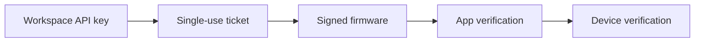

Local flash has four trust boundaries. Keep them separate.

## Trust boundaries

| Layer | Protects | Notes |
| --- | --- | --- |
| API key | Who may request firmware | Scoped to `ota:read`; optional artifact-code binding. |
| Installation key (enrollment mode) | Per-client identity | ES256 P-256 key in a platform secure store; access token bound to its thumbprint (DPoP). |
| Ticket | One download, short window | 32-byte random, SHA-256 at rest, five-minute expiry, single use. |
| Firmware signature | What the app may flash | RSA/SHA-256 over the image; verify with the pinned public key. |
| Device verification | What the device may run | Signature check at boot, plus anti-rollback where provisioned. |

## Key storage by client

| Client | Where the API key lives |
| --- | --- |
| Native app (example: desktop) | Platform secure store |
| Enrolled installation (enrollment mode) | Installation key in a platform secure store; API key only for enrollment |
| Web app with a backend | Server secret manager |
| Web app with a local agent | Agent platform secure store |
| Browser only | Not supported; never in `localStorage` or page JavaScript |

Read [Client patterns](/local-flash/client-patterns) for the matching flows.

## Tickets

- The raw ticket is returned once by `POST /flash/downloads`.
- Firmngin stores only the SHA-256 hash.
- A ticket is bound to the workspace, firmware, and flash session.
- A ticket expires after five minutes or on first use, whichever comes first.
- A redeemed ticket returns `410` on a second request.

Treat the ticket as a short-lived capability, not as a long-lived credential. Do not log it or put it in analytics.

## Artifact code binding

The API key can be limited to specific artifact codes:

- **Empty binding:** all signed firmware in the workspace.
- **Filled binding:** only the selected artifact codes.

The binding is enforced on the firmware list, manifest, download creation, session read, and session report. It is not a substitute for the firmware signature; it limits what the key may request.

## Verify before you flash

1. Download the binary with the ticket.
2. Compute SHA-256 and compare it with the manifest and `X-Firmware-Sha256`.
3. Verify `X-Firmware-Signature` with the public key pinned in the app.
4. Compare the manifest target board and model with the connected device.
5. Compare the version and security version with the device.
6. Show the version, target, and SHA-256 to the user and ask for confirmation.
7. Flash.

If any check fails, do not flash. Do not ship a build with a "skip verification" switch.

## Temp files

If the app writes the binary to a temp folder:

- Use a private folder with owner-only permissions (`0700` on Linux and macOS).
- Create the file with owner-only permissions (`0600`) and a random name.
- Open with `O_NOFOLLOW` on platforms that support it.
- Hash while writing, then verify the final size and digest.
- Keep the verified bytes in memory, or keep the same file descriptor open and verify again immediately before flashing.
- Delete the file after the flash.

A path-based flasher can still race with another process. Prefer flashing from memory or from the verified file descriptor.

## Advisory reports

`POST /flash/sessions/{id}/report` records what the app observed:

- `success` or `boot_failed`
- reported version
- the session nonce

It does **not** update the device's authoritative firmware state. Device-origin events remain the source of truth. Today the MQTT path records `boot_failed` and `rolled_back`; a device-origin success event is not implemented yet, so treat an app `success` report as unverified. If the device is offline, the dashboard shows the session as reported by the app, not as device-confirmed.

## Limits and abuse controls

- Ticket creation and download are rate-limited.
- Successful downloads are metered through `ota_downloads`.
- API keys can be revoked at any time; revoked keys stop working on the next request.
- A ticket cannot be reused after it is redeemed.

## Security checklist

- [ ] API key scope is `ota:read`, not a broader scope.
- [ ] Artifact-code binding is set when the app should only flash one product family.
- [ ] Firmware public key is pinned in the app.
- [ ] The app rejects unsigned artifacts.
- [ ] The app verifies SHA-256 and signature before flashing.
- [ ] Temp files use private permissions and random names.
- [ ] The device verifies the signature at boot.
- [ ] The app treats reports as advisory, not as device truth.
