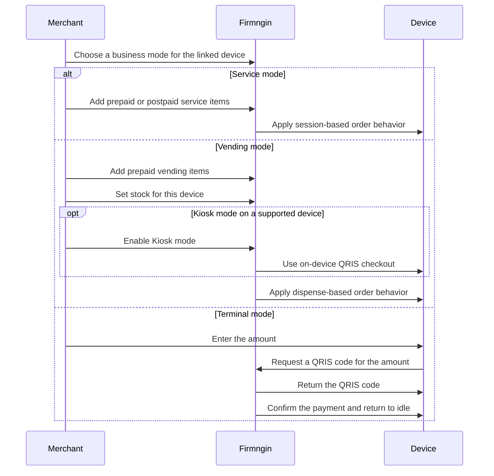

Business mode decides how a linked device delivers what the customer paid for. Each linked device uses one mode: **Service**, **Vending**, or **Terminal**.

Business mode is different from prepaid and postpaid. Prepaid and postpaid describe _when_ the customer pays. Business mode describes _what happens_ after the order is confirmed.

## Service, Vending, or Terminal

|  | Service | Vending | Terminal |
| --- | --- | --- | --- |
| What the customer buys | Time-bound or usage-bound use of the device | One or more physical items | A payment for an amount the merchant enters on the device |
| What happens after payment | A session starts on the device | The device dispenses the paid units | The device confirms the payment and is ready for the next transaction |
| Items per order | One item per order | Multiple items in one cart | No catalog items, one amount per transaction |
| Payment type | Prepaid or postpaid | Prepaid only | Paid upfront with QRIS |
| Per-device inventory | Not used | Vending Stock per device | Not used |
| Session tracking | Yes, with start, end, and duration | No, the order completes at dispense | No, the transaction completes at payment |
| Public page | Store page with single-item checkout | Store page with a cart | Not available |
| Kiosk mode | Not available | Available on supported devices | Not available |
| Examples | Laundry, massage chair, EV charging, locker storage | Snack machine, drink dispenser, capsule vendor | Counter payment device, cashier QRIS display, pay-at-device stand |

<CardGroup cols={3}>
  <Card title="Service Mode" icon="timer" href="/monetization/service-mode">
    Session-based use of the device after payment.
  </Card>

  <Card title="Vending Mode" icon="box" href="/monetization/vending-mode">
    Instant dispense after payment, with a multi-item cart and per-device stock.
  </Card>

  <Card title="Terminal Mode" icon="qr-code" href="#terminal-mode">
    Enter an amount on the device and let the customer pay by scanning a QRIS code.
  </Card>
</CardGroup>

## Terminal mode

Terminal mode turns a linked device into a QRIS payment terminal. The merchant enters an amount on the device, the device shows a dynamic QRIS code for that amount, and the customer scans it with any QRIS-enabled banking or e-wallet app.

Terminal mode does not use the catalog, the public store page, sessions, or dispense. Each payment is recorded as a transaction for the device and the merchant it belongs to.

Terminal mode is supported on Python and Arduino devices. Your device application handles amount entry and shows the QR code on its own screen or display.

### How a terminal payment works

1. The merchant enters the amount on the device.
2. The device shows a QRIS code for exactly that amount.
3. The customer scans the code and pays.
4. Firmngin confirms the payment and notifies the device.
5. The device returns to idle and is ready for the next amount.

The customer pays exactly the amount entered on the device. No fees are added on top of that amount. Applicable payment fees are deducted from your settlement, as described in [Payment Channels](/payment-channels).

### Amount and QR rules

- The amount is a whole number in IDR, with no decimals.
- The minimum amount is IDR 1,000 and the maximum is IDR 99,999,999.
- A QRIS code stays valid for up to one hour. After that it expires and can no longer be paid.
- A device can only have one pending QR code at a time. A new amount is refused until the current payment is paid, expires, or is cancelled.
- The device only accepts a new amount while it is idle and the merchant can accept transactions.

<Tip>
  If the merchant entered the wrong amount, cancel the pending transaction instead of waiting for it to expire. You can cancel from the device application, if it supports cancelling, or from the dashboard.
</Tip>

### Transactions

When a device uses Terminal mode, the linked device drawer replaces **Sessions** with **Transactions**. The list shows only Terminal QRIS transactions for that device, so orders from an earlier business mode on the same device stay out of it.

Open a transaction to see its status, time, and the payment and transaction process events in order. For a pending transaction you can:

- See the QRIS code that the customer still needs to scan.
- Select **Cancel** to invalidate the QR code so the customer can no longer pay it. Cancelling cannot be undone. A transaction that is already paid cannot be cancelled.
- Select **Simulate payment** to mark the payment as paid without real money. This option only appears for test/debug merchants, where supported.

\[image:Terminal Transactions list and transaction detail with the QRIS code, Cancel, and Simulate payment actions\]

A pending Terminal transaction is also cancelled automatically when:

- The device status is changed to idle or maintenance.
- The device is switched to another business mode.
- The device is unlinked from the merchant, deleted, or linked to another merchant.

If the payment was already collected, or its status cannot be confirmed yet, unlinking or switching business mode is refused so the transaction does not disappear. Try again after the transaction resolves.

<Warning>
  Do not cancel, unlink, or switch business mode while a customer is in the middle of paying. If the payment completes first, it is recorded as paid and cannot be cancelled.
</Warning>

## Set the business mode

1. Open **Monetization** in the dashboard and select your merchant.
2. Go to **Linked Devices**.
3. Open the setup drawer for the device you want to configure.
4. Find the **Business Mode** card.
5. Choose **Service**, **Vending**, or **Terminal**.

The dashboard confirms the change after it is saved.

\[image:linked device setup drawer showing the Business Mode card with Service, Vending, and Terminal options\]

<Note>
  Business mode is set per linked device, not per merchant. One merchant can have service, vending, and terminal devices at the same time.
</Note>

## What changes when you switch

Switching business mode changes the dashboard setup and the customer experience.

| Area | Service | Vending | Terminal |
| --- | --- | --- | --- |
| Device drawer menu | Overview, Sessions, Map Entity, Flow | Adds **Vending Stock** | Overview and **Transactions** only |
| Public page | Single-item checkout | Cart with quantity per item | Store page is disabled |
| Catalog items used | Prepaid and postpaid items | Prepaid items only | None |
| After payment | Session controls on the order page | Dispense and receipt | Device returns to idle for the next amount |

Switching a device to **Service** or **Terminal** also turns **Kiosk mode** off, because kiosk is a vending-only option.

Switching a device to **Terminal** disables its public store page. Visitors who open the page see that the store page is disabled, and orders cannot be placed from it. Map Entity, Flow, and verification settings are hidden while the device is in Terminal mode.

Switching a device out of **Terminal** cancels any pending Terminal transaction on that device first, so its QR code can no longer be paid and the device clears it. If a customer already paid the transaction, or the cancellation cannot be confirmed yet, the switch is refused and the device stays in Terminal mode. Let the paid transaction settle, or try again in a moment.

## Choose the right mode

Choose **Service** when the customer pays to use the device for a period of time or for measured usage, and the order should stay open until the session ends.

Choose **Vending** when the customer pays for physical units and the order is complete as soon as the device dispenses them.

Choose **Terminal** when the amount changes from one customer to the next, and you want to collect it as a QRIS payment on the device instead of selling catalog items.

<Warning>
  Review your catalog after switching modes. Postpaid and usage-based items cannot be sold from a vending device, so they stay unavailable on that device's public page. A terminal device does not sell catalog items at all.
</Warning>

## Checklist

Before opening the device to customers:

- The device uses the intended business mode.
- Catalog items match the mode's supported payment types.
- Vending devices have stock reviewed for every item sold on that device.
- Flow settings, verification, and stop behavior are tested in the selected mode.
- The public page has been reviewed end to end.
- Terminal devices have been tested with a paid transaction and a cancelled transaction, using **Simulate payment** on a test/debug merchant.
