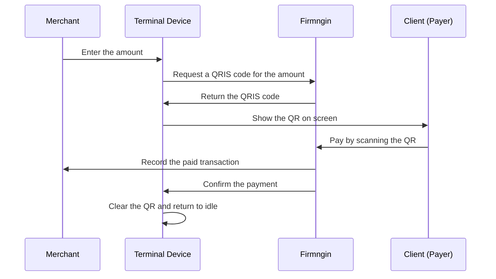

Terminal mode turns a linked device into a QRIS payment terminal. The merchant enters an amount on the device, the device shows a dynamic QRIS code for that amount, and the customer scans it with any QRIS-enabled banking or e-wallet app. There is no catalog, cart, or session, so the transaction completes as soon as the payment is confirmed.

Common terminal use cases:

- A payment device at a counter or cashier.
- A QRIS display for amounts that change from one customer to the next.
- A pay-at-device stand where staff key in the total.
- Any device that should collect a payment without selling catalog items.

## How a terminal payment works

<Steps>
  <Step title="Merchant enters the amount">
    The merchant or staff types the amount on the device while it is idle.
  </Step>
  <Step title="Device shows the QR code">
    The device shows a QRIS code for exactly that amount. The customer pays exactly the amount entered on the device.
  </Step>
  <Step title="Customer pays">
    The customer scans the code with a QRIS-enabled banking or e-wallet app and completes the payment.
  </Step>
  <Step title="Payment is confirmed">
    Firmngin confirms the payment, records the transaction, and notifies the device.
  </Step>
  <Step title="Device is ready again">
    The device clears the QR code and returns to idle, ready for the next amount. No session stays open.
  </Step>
</Steps>

See [Fee timing](/payment-channels#fee-timing) for fees.

## Supported devices

Terminal mode is supported on Python and Arduino devices, as shown in the **Business Mode** card in the dashboard. Your device application handles amount entry and shows the QR code on its own screen or display.

## Enable terminal mode

1. Open **Device Billing** in the dashboard and select your merchant.
2. Go to **Linked Devices**.
3. Open the setup drawer for the device you want to configure.
4. In the **Business Mode** card, select **Terminal**.

The dashboard confirms the change after it is saved.

\[image:Business Mode card with Terminal selected\]

When a device uses Terminal mode:

- The public store page is disabled. Visitors who open it see that the store page is disabled, and no orders can be placed from it.
- Catalog items are not used on that device.
- **Map Entity**, **Flow**, and verification settings are hidden.
- **Kiosk mode** is turned off, because kiosk is a vending-only option.
- The linked device drawer shows **Overview** and **Transactions**.

## Amount and QR rules

| Rule | Detail |
| --- | --- |
| Currency | IDR only |
| Amount format | Whole numbers, no decimals |
| Minimum amount | IDR 1,000 |
| Maximum amount | IDR 99,999,999 |
| QR validity | Up to one hour, after which the QR code expires and can no longer be paid |
| Pending QR codes | One per device at a time |

### One pending QR per device

A device can only have one pending QR code at a time. While a QR code is waiting to be paid, the device refuses a new amount. It accepts a new amount again once the current payment is paid, expires, or is cancelled.

If the merchant entered the wrong amount, cancel the pending transaction instead of waiting for it to expire. You can cancel from the device application, if it supports cancelling, or from the dashboard.

### When a new amount is refused

| Situation | What to do |
| --- | --- |
| Another QR code is still pending on the device | Wait for it to be paid, or cancel it |
| The amount is below IDR 1,000, above IDR 99,999,999, or has decimals | Enter a whole amount within the limits |
| The device is not idle, for example in maintenance | Return the device to idle |
| The merchant cannot accept transactions, for example because the plan quota is exhausted or the merchant is disabled | Resolve the merchant status, see [Plan limits](/monetization#plan-limits) |
| The device is no longer in Terminal mode | Switch the device back to **Terminal** |

## Transactions

The **Transactions** view in the linked device drawer replaces **Sessions** for terminal devices. It lists only Terminal QRIS transactions for that device, so orders from an earlier business mode on the same device stay out of it.

Open a transaction to see its status, time, and the payment and transaction process events in order. For a pending transaction you can:

- See the QRIS code that the customer still needs to scan.
- Select **Cancel** to invalidate the QR code so the customer can no longer pay it.
- Select **Simulate payment** to mark the payment as paid without real money. This option only appears for test/debug merchants, where supported.

\[image:Terminal Transactions list and transaction detail with the QRIS code, Cancel, and Simulate payment actions\]

<Warning>
  Cancelling cannot be undone. A transaction that is already paid cannot be cancelled.
</Warning>

## Automatic cancels

A pending Terminal transaction is cancelled automatically, and the device clears its QR code, when:

- The device status is changed to idle or maintenance.
- The device is switched to another business mode.
- The device is unlinked from the merchant, deleted, or linked to another merchant.

If the payment was already collected, or its status cannot be confirmed yet, unlinking or switching business mode is refused so the transaction does not disappear. Let the paid transaction settle, or try again in a moment.

<Note>
  Do not cancel, unlink, or switch business mode while a customer is in the middle of paying. If the payment completes first, it is recorded as paid and cannot be cancelled.
</Note>

## Switching modes

Switching a device out of **Terminal** cancels any pending Terminal transaction on that device first, so its QR code can no longer be paid. If a customer already paid the transaction, or the cancellation cannot be confirmed yet, the switch is refused and the device stays in Terminal mode.

After switching to **Service** or **Vending**, review the device's catalog items, **Map Entity**, **Flow**, and public store page before opening it to customers. See [Business Modes](/monetization/business-modes) for what changes in each mode.

## Limits

Terminal mode does not support:

- Catalog items, carts, or per-device stock.
- The public store page or customer checkout from a phone.
- Sessions, session controls, or dispense.
- Prepaid or postpaid catalog pricing. Each transaction is a single amount paid upfront with QRIS.
- Kiosk mode.

<Note>
  Use [Vending Mode](/monetization/vending-mode) with kiosk mode when customers should pick catalog items and pay on the device screen.
</Note>

## Terminal flow

## Checklist

- The device's business mode is set to **Terminal**.
- The device is a supported Python or Arduino device, and its application can enter amounts and show the QR code.
- A test transaction has been paid with **Simulate payment** on a test/debug merchant.
- A pending transaction has been cancelled from the dashboard, and the device cleared its QR code.
- Staff know that only one QR code can be pending at a time, and how to cancel a wrong amount.
- The merchant has been approved for live payments before collecting real customer payments.
